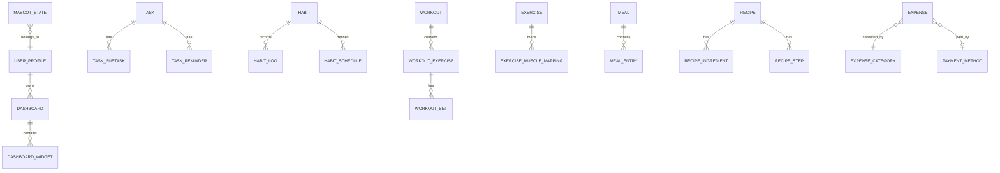

# Data model

## 1. Principles

- Normalized relational design with stable primary keys and foreign keys.
- Client-generated UUIDv7 identifiers; local IDs never change during synchronization ([ADR-0004](../adr/0004-identity-clocks-revisions.md)).
- Local and server schemas are logically identical; only DDL syntax differs.
- Timestamps follow the time model in [ADR-0006](../adr/0006-time-model.md); money follows [ADR-0007](../adr/0007-money-model.md).
- Derived values are not stored as truth; indexes may be maintained for query speed.
- Deletions are tombstones until retention expiry.
- Schema changes require migrations on both clients and the server.

## 2. Domain overview

## 3. v1 entity dictionary

Every table carries `id`, `revision`, `hlc_created`, `hlc_updated`, and nullable `hlc_deleted` unless stated otherwise.

### Application

| Entity | Key columns / notes |
| --- | --- |
| `UserProfile` | display name, optional image ref, timezone (IANA), locale, date/time format, first day of week |
| `AppSettings` | keyed settings rows (`key`, `value` JSON) for LWW-per-key synchronization |
| `Dashboard` | name, order index, is default, theme override ref |
| `DashboardWidget` | dashboard ref, widget type, grid x/y/w/h, visibility, background/accent tokens, config JSON |
| `ThemePreset` | built-in or custom, light and dark token maps |
| `Device` | device id, label, platform, authorized flag, last seen, cursor |
| `NotificationPreference` | category key, enabled, quiet hours, snooze, sound/vibration flags |
| `MascotState` *(added — absent from source spec)* | profile ref, companion variant, plant/tree style, stage derived from habit logs, animation preferences |

### Tasks

| Entity | Key columns / notes |
| --- | --- |
| `Task` | title, description, priority (Very High … Low), status, category ref, `due_date` (local DATE), optional start/end time, recurrence ref |
| `TaskCategory` | name, color token |
| `TaskSubtask` | task ref, title, completed, independent completion timestamp |
| `TaskRecurrence` | rule JSON (RFC-like), timezone-aware next-occurrence generation |
| `TaskReminder` | task ref, offset, enabled |

### Habits

| Entity | Key columns / notes |
| --- | --- |
| `Habit` | name, description, icon, accent token, target value optional, archived/paused flags |
| `HabitSchedule` | habit ref, daily / selected weekdays / custom rule, timezone-aware |
| `HabitLog` | habit ref, `local_date`, status (done / skipped / rest), optional target value, timestamp — append-only |
| `HabitReminder` | habit ref, time, enabled |

### Gym

| Entity | Key columns / notes |
| --- | --- |
| `Exercise` | name, category, notes, custom flag |
| `MuscleGroup` | name, front/back diagram region key |
| `ExerciseMuscleMapping` | exercise ref, muscle ref, primary/secondary |
| `Workout` | started/stopped instants, duration, notes, completed flag |
| `WorkoutExercise` | workout ref, exercise ref, order index |
| `WorkoutSet` | **one row per set**: workout exercise ref, set number, reps, weight, completed flag, completion timestamp |
| `PersonalRecord` | exercise ref, metric, value, achieved instant |

> Critical rule: a workout is never stored as one shared repetition/weight value. Editing set 2 cannot affect set 3.

### Food

| Entity | Key columns / notes |
| --- | --- |
| `Food` | name, serving size, source enum (manual / reserved import), nullable `source_ref` |
| `FoodNutrition` | food ref, calories, protein, carbs, fat per serving |
| `Meal` | `local_date`, meal type (Breakfast/Lunch/Dinner/Snack) |
| `MealEntry` | local date, meal type, food or recipe ref, quantity in servings, optional image ref, notes, logged instant |
| `MealPlan` | local date, meal type, food or recipe ref, quantity in servings, optional notes, planned instant; explicit planned record for planned-versus-consumed analytics |
| `Recipe` | name, image ref, prep/cook minutes, servings, favorite, notes |
| `RecipeIngredient` | recipe ref, food ref, quantity |
| `RecipeStep` | recipe ref, order index, instruction text |
| `NutritionGoal` | local date, calories/protein/carbs/fat targets |

### Cardio

| Entity | Key columns / notes |
| --- | --- |
| `WalkingSession` | start/end instants, steps, duration, optional distance, optional calories, sensor/source flags |
| `StepRecord` | date, step count, source, deduplication key — append-only |
| `JumpRopeSession` | duration, jump count, `count_source` (manual / sensor_assisted), rounds, rest periods |
| `CyclingSession` | start/end instants, pause intervals, distance, average/max speed, source quality flags |
| `CyclingLocationPoint` | **defined but not written in v1**; session ref, instant, lat/lon, accuracy, filtered flag |

No cardio value is invented when a sensor or GPS reading is unavailable or rejected; the field stays null and the UI shows an unavailable state.

### Finance

| Entity | Key columns / notes |
| --- | --- |
| `Expense` | name, `local_date`, category ref, `amount_minor` (paise), `currency` (INR), payment method ref, nullable `card_label`, notes |
| `ExpenseCategory` | name, color token, custom flag |
| `PaymentMethod` | enum-backed: Cash, UPI, Debit Card, Credit Card, Net Banking, Other |

`card_label` is editable only when the payment method is Credit Card. No `CreditCard`, `Budget`, `Income`, or `RecurringExpense` table in v1.

### Synchronization

| Entity | Key columns / notes |
| --- | --- |
| `SyncOperation` (outbox) | entity, entity id, op type, payload, idempotency key, HLC, attempts, next attempt |
| `SyncCursor` | device ref, last applied server HLC |
| `SyncConflict` | entity, field, local value, incoming value, base value, status, resolution record |
| `SyncMetadata` | last successful sync, pending count, last error |
| `BackupMetadata` | backup id, created instant, checksum, encryption details, verified flag, retention |

## 4. Deferred but forward-compatible

Defined as a boundary in contracts; no tables are created in v1:

- **Reading:** `Book`, `ReadingSession`, `ReadingNote`, `BookQuote`, `BookReview`
- **Journal:** `JournalEntry`, `JournalAttachment`, `JournalTag`, `JournalMood` — encrypted content fields planned ([ADR-0015](../adr/0015-authentication-encryption.md))
- **Calendar:** `CalendarEvent`, `CalendarReminder` — later implemented as a projection over existing due dates and schedules, not copies
- **Finance:** `Income`, `Budget`, `CreditCard`, `RecurringExpense`
- **Cardio:** writes to `CyclingLocationPoint`

## 5. Critical data rules (from §16.3)

| Rule | Enforcement |
| --- | --- |
| Every gym set is an individual record | Schema + unit test that two sets of one exercise can hold different reps/weight independently |
| Every journal entry has its own instant | Deferred schema includes timezone-aware instant fields |
| Every task supports independent completion | Task and subtask completion are separate columns |
| Every habit log links to its habit | Non-null foreign key |
| Food/recipe references are stable | In-use food and recipe records cannot be deleted; meal entries and plans keep their referenced record id |
| Planned nutrition is never inferred from entries | Explicit `MealPlan` records are compared with `MealEntry` records by local date |
| Dashboards/widgets have independent configuration | Configuration JSON owned by `DashboardWidget` row |
| Finance card reference is optional | Nullable `card_label`; required only by UI validation for Credit Card |
| Cycling route points optional and separate | Separate table, not written in v1 |
| Consistent timezone strategy | [ADR-0006](../adr/0006-time-model.md) |
| Local IDs stable during sync | [ADR-0004](../adr/0004-identity-clocks-revisions.md) |

## 6. Indexes, deletion, and integrity

- Index foreign keys, `local_date`, `hlc_updated`, and status columns used by list views and analytics.
- Unique constraints on natural deduplication keys (e.g., `StepRecord` source + date + source event id).
- Foreign keys use explicit deletion behavior: `RESTRICT` for lookup data in use, tombstones for user records, cascade only for owned children such as subtasks and recipe steps.
- The server validates all incoming records; validation failure returns a structured error and leaves the local record and outbox entry intact for correction.
