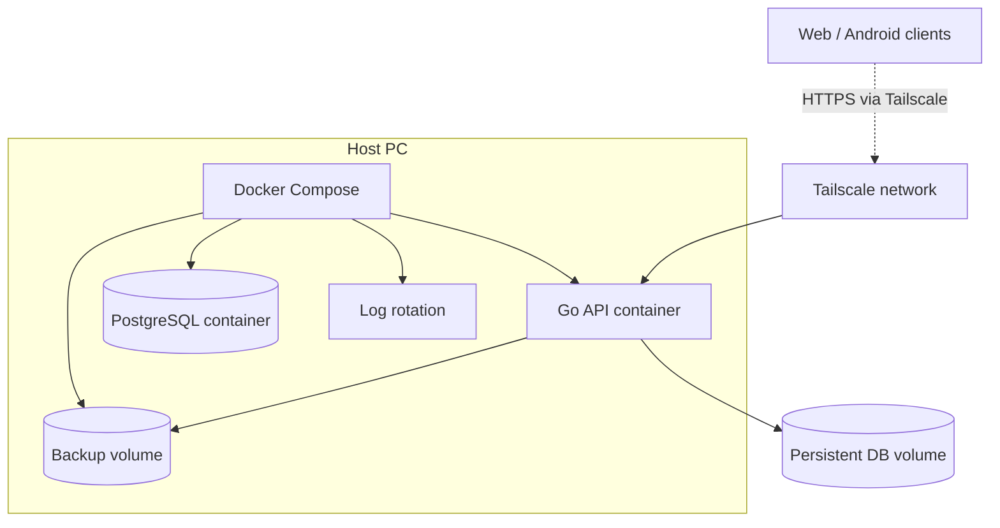

# Operations, deployment, and recovery

## 1. Environments

| Environment | Purpose | Data |
| --- | --- | --- |
| Development | Local Windows toolchains, Docker services | Synthetic fixtures only |
| Self-hosted production | User's PC, Docker Compose | Real local-first data and backups |
| Device (Android/web) | Offline-capable clients | Local DB, encrypted sensitive fields |

Configuration comes from environment variables with committed `.env.example` templates. Secrets are never committed; production secrets are supplied at deploy time.

## 2. Deployment topology

- PostgreSQL is attached only to the private Docker network; no host port is published publicly.
- HTTPS terminates at the server boundary; remote access is restricted to Tailscale.
- Migrations run as a controlled startup step and are versioned.
- Health checks, restart policies, and log rotation are configured for every long-lived container.
- The server is explicitly allowed to be offline; clients continue locally.

## 3. Backup and restore

- **Full backup:** versioned archive of database, attachments, and settings metadata.
- **Encryption:** backups are encrypted with a versioned scheme; keys follow [ADR-0015](../adr/0015-authentication-encryption.md).
- **Verification:** checksum plus a test restore; a backup is not considered valid until restored successfully.
- **Modes:** manual and scheduled; frequency and retention configurable; oldest backups pruned by retention policy.
- **Import/export:** JSON export of all data, CSV where appropriate, individual module export, and validated import with duplicate detection.
- **Destructive operations:** full data deletion and module deletion require explicit confirmation and produce an export/backup offer first.

### Restore runbook outline

1. Stop writes to the target instance.
2. Verify backup checksum and encryption key availability.
3. Restore to a scratch database first; run schema and integrity checks.
4. Compare record counts and critical fixtures with the backup manifest.
5. Swap into place, restart services, and verify health checks.
6. Force clients to re-sync and confirm no data loss or duplication.

Interrupted backup, interrupted restore, database corruption, and full-device migration are explicit test scenarios.

## 4. Logging and monitoring

- Structured logs with trace ID, device ID, entity type, status, and duration.
- No journal content, tokens, secrets, or sensitive values in logs or crash reports.
- Health endpoint reports API/database status; sync status and pending counts are visible in client settings.
- Log rotation and bounded retention prevent unbounded disk growth.

## 5. Release

- Web: production build with configured API URL, static hosting, offline behavior and update behavior tested.
- Android: signed release build, versioning, permissions reviewed, install/upgrade/widget/offline tests on devices.
- Documentation: installation, server administration, backup, restore, troubleshooting, privacy/security, feature docs, release notes.
