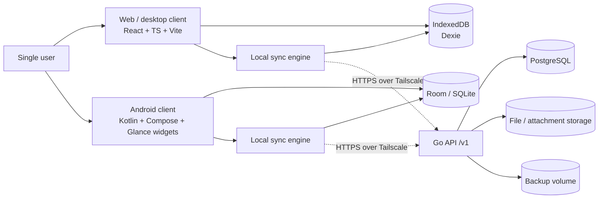
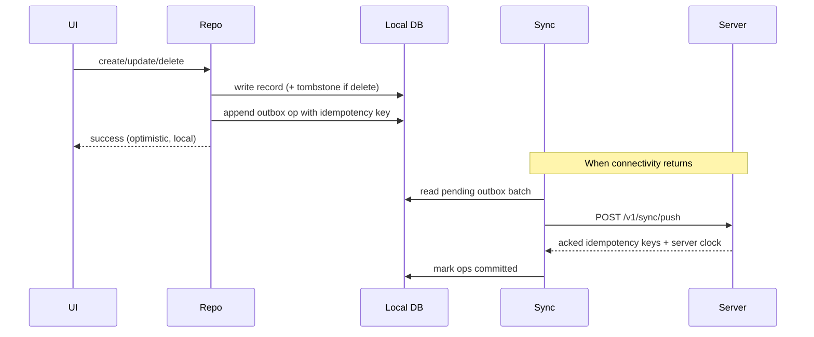

# Architecture overview

## 1. System context



The server is optional at runtime. Both clients are fully functional with the server unreachable; the server provides synchronization, backup, and remote device access only.

## 2. Component responsibilities

| Component | Responsibility | Never does |
| --- | --- | --- |
| UI (web / Android) | Render modules, collect input, respect theme and locale | Query the server or another module's tables directly |
| Local repository | Own reads/writes for one module's tables; append outbox operations | Contain business-rule differences between platforms |
| Local database | Durable source of truth for the device; supports offline search and analytics | Trust server responses as authoritative over unsynced local data |
| Sync engine | Outbox push, cursor pull, conflict detection/resolution, attachment transfer, retry | Mutate user data to resolve a conflict automatically when unsafe |
| Server API | Validate, authorize, persist, version, and serve changes | Require continuous availability for client functionality |
| Analytics layer | Compute derived values from local records | Store computed values as competing truth |
| Contract packages | Schemas, tokens, strings, and calculation fixtures shared by both clients | Depend on platform code |

## 3. Runtime flows

### 3.1 Offline write



The UI never waits for the server. A failed push leaves the operation queued with backoff; the local record remains valid.

### 3.2 Synchronization cycle

1. Read pending outbox operations.
2. Push a batch with idempotency keys and client HLC values.
3. Pull changes since the stored per-device cursor.
4. Apply incoming changes with three-way field merge against stored base revisions.
5. Append unresolved conflicts to the manual resolution queue.
6. Persist cursor, sync status, and history; repeat on network transitions.

## 4. Technology stack

Confirmed by [ADR-0001](../adr/0001-technology-stack.md). Exact versions are pinned by lockfiles when toolchains are scaffolded; CI fails on stale locks.

| Layer | Technology |
| --- | --- |
| Web frontend | React + TypeScript + Vite |
| Web styling | Tailwind CSS with generated design-token variables |
| Charts | Apache ECharts |
| Web local database | IndexedDB via Dexie |
| Android | Kotlin + Jetpack Compose |
| Android local database | Room |
| Android widgets | Jetpack Glance |
| Backend | Go, REST + OpenAPI 3.1 |
| Central database | PostgreSQL, queries via SQLC |
| Synchronization | Custom offline-first engine (outbox + HLC + merge) |
| Deployment | Docker Compose, remote access over Tailscale |
| Testing | Unit, integration, offline scenario, UI, device, security |

## 5. Repository map

```text
MyFlow/
├── apps/
│   ├── web/                  # React client (planned)
│   └── android/              # Kotlin client (planned)
├── server/                   # Go API (planned)
├── contracts/
│   ├── openapi/              # OpenAPI 3.1 documents
│   ├── schemas/              # JSON Schema entity definitions
│   ├── tokens/               # Design token JSON (source of truth)
│   ├── i18n/                 # en / ta message bundles
│   └── fixtures/             # Shared calculation test fixtures
├── packages/                 # Generated/shared code (planned)
├── docs/                     # Decisions, ADRs, architecture
└── deployments/              # Docker Compose, env templates (planned)
```

## 6. Architecture invariants

1. All UI reads come from the local database.
2. Both clients compile against one contract set.
3. Append-only records are preferred; conflicts are surfaced, never silently resolved against the user.
4. Analytics and progress indicators are derived from source records.
5. Tokens and user-facing strings are externalized; contrast and string lints run in CI.
6. Destructive actions require confirmation and produce tombstones.

## 7. Glossary

| Term | Meaning |
| --- | --- |
| HLC | Hybrid logical clock — physical time plus logical counter and device ID; orders events across skewed clocks |
| Outbox | Durable local queue of pending mutations awaiting synchronization |
| Tombstone | Deletion marker that propagates to other devices instead of a hard delete |
| Base revision | The last server-confirmed version a client merged against, used for three-way merges |
| Projection | Read-only view assembled from other modules' data, stored nowhere |
| Fixture | Shared JSON input/expected-output pair used to verify identical calculations on both clients |
